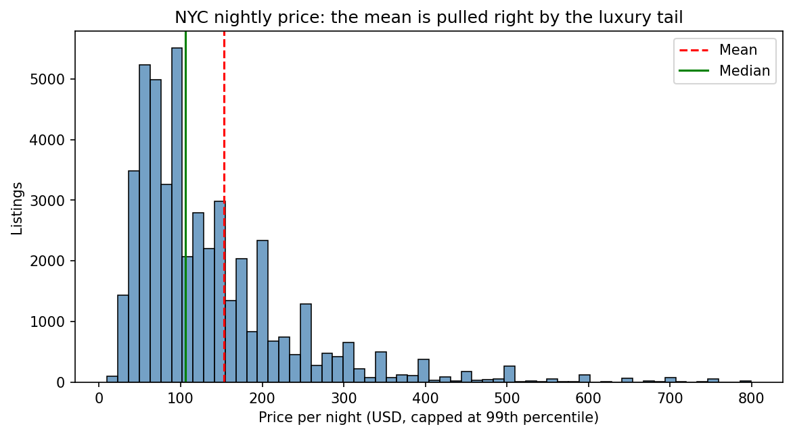
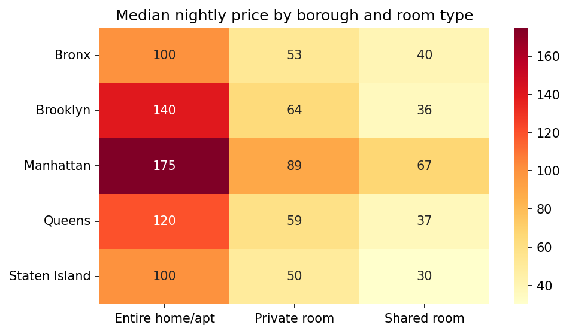
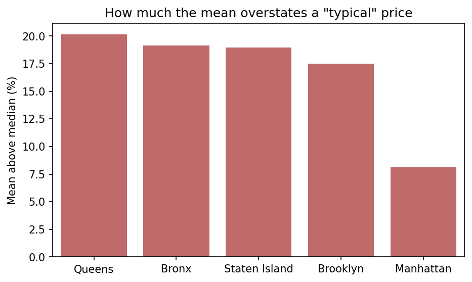
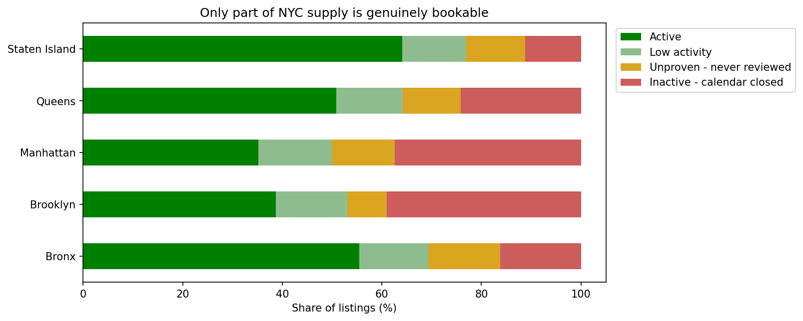
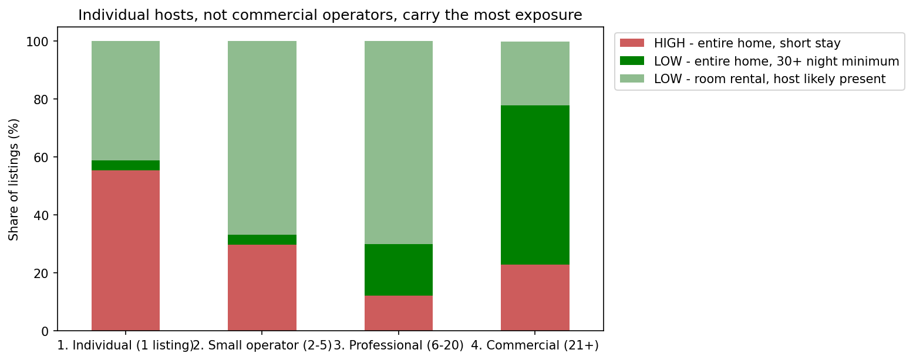

# NYC Airbnb: Pricing, Supply-Health & Regulatory Diagnostic

An end-to-end analysis of ~49,000 New York City Airbnb listings (2019 snapshot), framed as a brief from the NYC Market Operations team. The goal was to answer three business problems with defensible numbers, and to state clearly what the data cannot tell us.

**Tools:** Python, pandas, NumPy, SciPy, Matplotlib, Seaborn

---

## The Business Problems

1. **Pricing:** Hosts say Smart Pricing guidance is wrong. Bronx hosts say it's too high; Tribeca hosts say it's too low. Is the engine anchored on a mean dragged up by luxury listings?
2. **Supply:** The dashboard says "48,895 active listings." How many are actually bookable?
3. **Regulation:** NYC restricts renting an entire home for under 30 nights. How much inventory and revenue sits in that at-risk category, and who holds it?

---

## Key Findings

### 1. Use the median, not the mean, for pricing guidance
- Raw mean price is **$152.72** vs. a median of **$106**, which is 44% higher. The standard deviation ($240) is **5.2x the MAD ($46)**.
- Removing the 6.1% of listings above the IQR fence ($334) cut the standard deviation by **72%** while the median moved only **5.7%**. That shows the outlier policy removed volatility, not signal.
- **Room type matters more than borough.** A Bronx entire home (median $100) out-prices a Manhattan private room ($89).
- The mean overstates the median in every borough and room type, and by the most in the cheapest boroughs (e.g. Staten Island entire homes +$21). That is why the complaints came from the Bronx and not Tribeca.

### 2. Headline supply is overstated by about 2.6x
- **35.9%** of listings show zero available nights. Cross-checking against reviews showed these are **dormant, not sold out**: they get ~0.08 reviews/month vs. 0.92 for listings with open calendars.
- Only **39.2%** (19,141 listings) qualify as genuinely *Active*.
- Manhattan and Brooklyn have the **worst** supply health (about 35-39% active), and the outer boroughs the best.
- A second, independent column (`last_review`) agrees: **35.1%** of reviewed listings were last reviewed before 2019.

### 3. Regulatory exposure is larger in revenue than in listings, and the usual narrative is reversed
- **45.5%** of listings are high-risk (entire home, under 30 nights), but they generate **67.5% of estimated revenue**.
- Exposure is concentrated in Manhattan (49.9% high-risk) and Brooklyn (44.4%).
- **Individual single-listing hosts are the most exposed (55.5% high-risk).** Commercial operators (21+ listings) already require 30+ night stays on **54.8%** of their listings, against 3.3% for individuals.
- Recommendation: aim compliance education at individual hosts, not commercial operators.

### Revenue estimate
| Model | Occupancy | Annual revenue |
|---|---|---|
| Naive (`365 - availability`) | 69.1% | $1.76 bn |
| **Defensible (open calendar + at least one review)** | **53.3%** | **$0.72 bn** |

The naive model is 2.4x too high because it treats every closed calendar as a fully booked year.

---

## Methodology Highlights

- **Missing data diagnosis.** `reviews_per_month` and `last_review` were missing for exactly the 10,052 never-reviewed listings, which I verified with `np.all()`. The missingness is structural, so `reviews_per_month` was filled with a known 0 rather than imputed.
- **Outlier policy.** I removed the 11 impossible $0 prices, and kept real luxury listings out of pricing guidance but in market-sizing. The IQR rule gave a lower fence of -$90 (meaningless for prices) and missed the $0 errors entirely, so I did not apply it mechanically.
- **Reliability gate.** Neighbourhood benchmarks are published only where there are at least 100 listings. This keeps 65 of 219 neighbourhoods and **91.4%** of listings.
- **Rejecting my own first model.** The naive revenue estimate is built first, shown to be implausible, and replaced.
- **Recency artifact.** Month-of-last-review looks like seasonality but only reflects when the data was extracted, so I did not use it for pricing advice.

---

## Visualizations

| | |
|---|---|
|  |  |
|  |  |
|  | |

---

## Limitations

- **Single 2019 snapshot.** There is no time series, so trend and seasonality can't be separated.
- **`availability_365` is a forward-looking calendar**, not a booking record. Occupancy and revenue are reasoned proxies.
- **Reviews are a proxy for stays.** Not every guest reviews, so activity is understated by an unknown factor.
- **`price` is the advertised nightly rate** and excludes fees, discounts and taxes.
- **No cost data**, so nothing here speaks to host profitability.
- **Regulatory flag is simplified** to entire home plus a minimum stay under 30 nights. Real compliance also depends on host presence, registration and building type.

